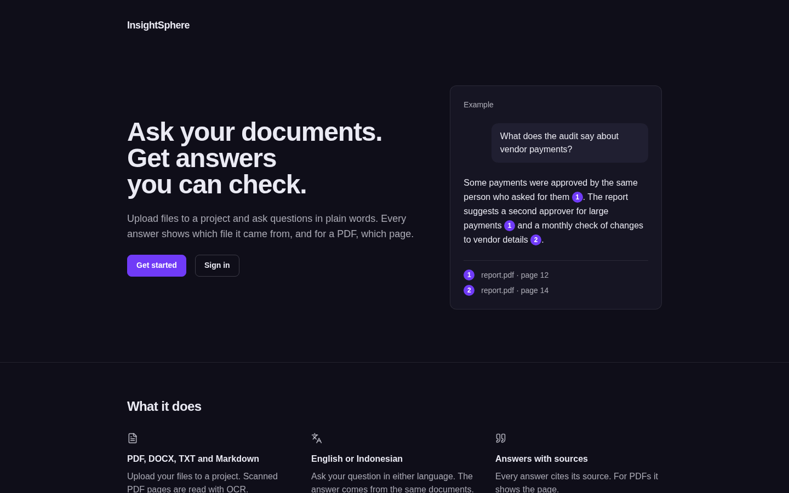
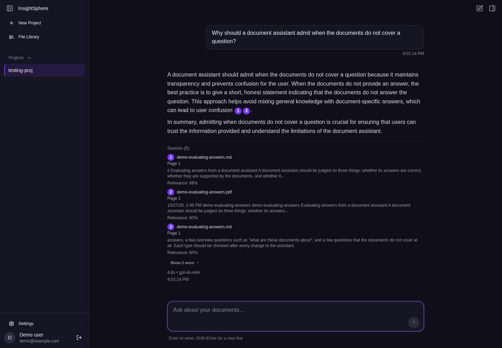
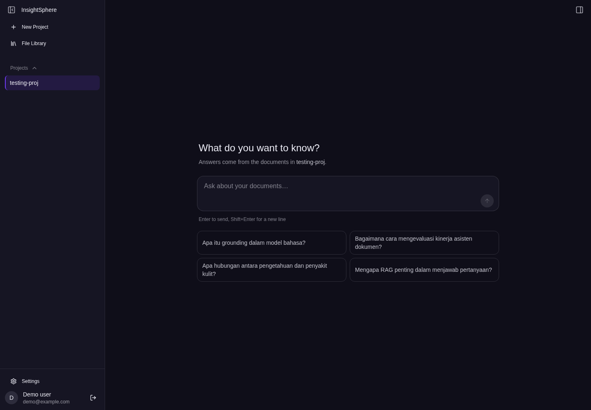
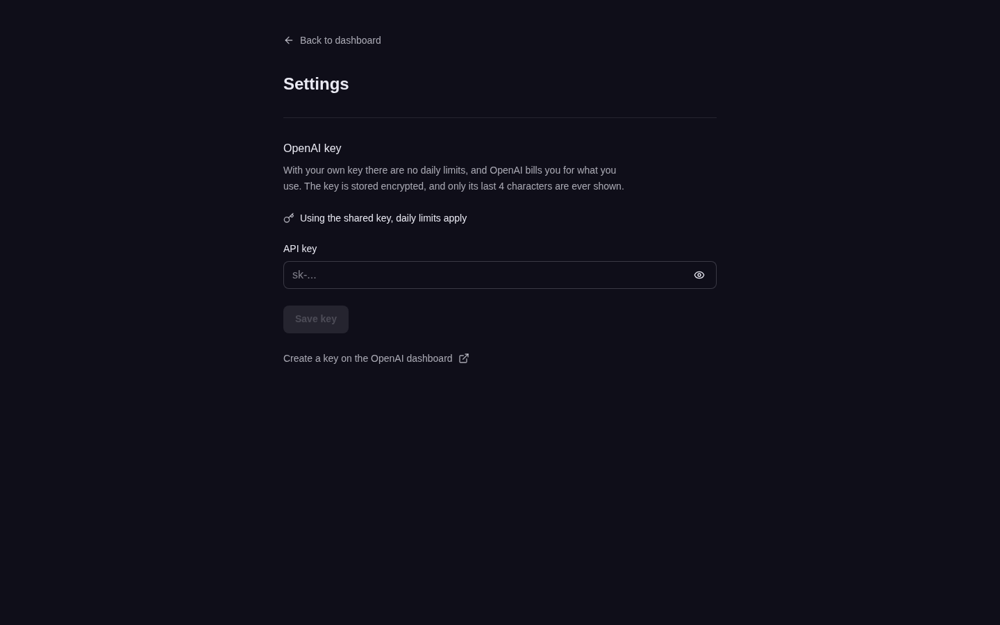

# InsightSphere

Upload documents to a project, then ask questions about them and get answers with citations back to the exact page.

- **PDF, DOCX, TXT and Markdown**, up to 100 MB and 1000 pages per file. A PDF page that has a text layer is read directly; only a page without one goes through OCR.
- **Answers cite their sources.** Numbered chips in the answer point to a source list with the file name and, for a PDF, the page.
- **Follow-up questions work.** A question like "and the second one?" is rewritten into a full question before the search.
- **A question router** sends a question about the documents as a whole to the document summaries, and gives a question that has nothing to do with them a short reply instead of a search.
- **Suggested questions** for each project, written from its documents' names and summaries.
- **Document summaries** for every supported format.
- **Daily quotas per user** and a burst limit of 20 requests a minute. A user can save their own OpenAI key, stored encrypted, and then the daily quotas do not apply to them.
- **Accounts** with email and password or Google, plus forgot-password and reset-password pages.









---

## How it works

```
  Browser (SvelteKit 2, Svelte 5)
      |  JWT
      v
  API (Deno + Hono) --------> doc-parser (Go)
      |                          |  pdftoppm  -> greyscale PNG per page
      |                          +- tesseract -> text per page
      |
      +--> OpenAI      embeddings + answer generation
      +--> Qdrant      one collection per project
      +--> Supabase    Postgres, auth, file storage
```

Ingestion, in order:

1. The browser uploads to Supabase Storage and inserts a row in `project_files`.
2. `POST /v1/documents/process` checks ownership and returns **202** straight away.
3. In the background: a PDF hands over the text it already carries, page by page, and only the pages that carry none are rendered and OCR'd; DOCX text is read out of its XML; plain text is read as-is.
4. Pages are split into chunks of about 800 tokens with a 50-token overlap, embedded with `text-embedding-3-small`, and upserted into that project's Qdrant collection.
5. The row moves to `ready`, or to `failed` with the reason recorded. The UI polls until then.

Answering a question:

```
  question
     |
  follow-up? --yes--> rewrite it to stand alone
     |                (gpt-4o-mini, 1.5 s limit; on failure keep the original)
     |                       |
     +<----------------------+
     |
  router: what kind of question is it?
  (gpt-4o-mini, 1.5 s limit)
     |
     +-- off-topic ------> short reply + example questions
     |                     (no search, no answer call)
     |
     +-- overview -------> answer from the stored document summaries,
     |                     one citation per document
     |                     (no summary yet -> specific path)
     |
     +-- specific, or the router failed or timed out
            |
         embed the question (and the rewrite, if there is one)
            |
         search only this project's collection, score >= 0.30
         (with a rewrite: two result lists, fused by reciprocal rank fusion)
            |
         drop duplicate passages, keep the top 5 in score order
            |
         gpt-4o-mini answers from those chunks only, citing [doc_id: N]
            |
         best score below 0.45 -> answer is given, and marked as a weak match
```

Asking a question embeds it with the *same* model as the documents, searches only that project's collection, and hands the top chunks to the model with instructions to answer from them alone. Each chunk carries its filename and page number, which become the clickable citations.

A follow-up question is rewritten into one that stands on its own before it is searched for, because "and what about the second one?" matches nothing on its own. Both the original and the rewrite are searched and the two result lists are fused, since a rewrite used alone retrieves worse than a rewrite plus the original. When the best chunk is still a weak match the answer is given anyway, and labelled as one.

Before any search, a small model call sorts the question into one of three kinds. A question about the documents as a whole ("what is the point of these papers?") matches no single chunk well enough to pass the similarity threshold, so it is answered from the stored document summaries instead, with one citation per document. A question that has nothing to do with the documents gets a short reply and a few example questions, and no search or answer is paid for. Everything else, and every case where that call fails or times out, takes the normal search path.

---

## Design decisions

**One Qdrant collection per project**, named `insightsphere-documents_user_{userId}_project_{projectId}`. Leaking across tenants would take the wrong collection name rather than a forgotten `WHERE` clause, and deleting a project becomes a single call. The cost is that search cannot span projects.

**Chunk IDs are deterministic** — a UUID v5 over `documentId_page_chunkIndex`. Qdrant upserts by point ID, so reprocessing replaces chunks rather than adding more. An earlier version returned a random UUID from a function whose name promised otherwise, which left 43% of the vector store as duplicates and meant a top-5 search could come back as the same paragraph five times.

**OCR is the fallback, not the default.** Most PDFs hold their own text, so it is taken directly and only pages that come back empty — a scan, a full-page figure — are rendered and read by tesseract. On a 14 page article that is 7 seconds instead of 136, and the text is exact rather than tesseract's reading of a picture of it. The decision is per page, because a scanned appendix inside a digital report is ordinary.

**Only PDF pays for OCR.** DOCX already holds its text in `word/document.xml`, and `.txt`/`.md` are text already, so both skip rendering entirely and finish in under a second. Markdown is kept as written rather than stripped: `## Results` is a better chunk boundary and a better embedding than `Results` on its own. Neither format records page breaks, so the whole file is stored as one page, and its citations show page 1.

**No embedding fallback.** If OpenAI is unavailable the request fails. A second provider means different dimensions, so the search would either error or quietly return nothing useful. Failing loudly is the cheaper outcome.

**Processing is detached from the request.** OCR on a large PDF runs for minutes and no proxy holds a connection open that long. The endpoint returns 202 and the client polls.

**Queries and documents are normalised the same way** before embedding. They were not, once, and the two halves of the search were built from different text.

---

## Quick start

Needs Docker, Node 24+, a Supabase project and an OpenAI key.

```bash
git clone https://github.com/abiyyubarraq/insightsphere.git
cd insightsphere

cp dev/.env.example dev/.env                 # fill in Supabase + OpenAI
cp frontend/.env.example frontend/.env       # Supabase URL + anon key, API URL
```

To let users save their own OpenAI key, also set `KEY_ENCRYPTION_SECRET` in `dev/.env` to the output of `openssl rand -base64 32`. It is optional: without it the settings routes answer 503 and everything else works. Keep it safe — losing or changing it makes every saved key unreadable, and users have to save theirs again.

A user with a saved key has every OpenAI call made for them (chat, query, document processing, summaries, search) sent with that key, and the daily quotas do not apply to them. The 20 requests a minute burst limit still does. If their key fails, the request fails with a message for them (400 for a rejected key, 429 when their OpenAI account has no credit); the server key is never used instead.

Apply the schema: in the Supabase SQL editor run the files in `supabase/migrations/` in order. They create the ten tables, switch on row level security for all of them, and add the policies. `0006_quota.sql` also adds the default quota tiers.

```bash
./dev/start.sh                   # qdrant + doc-parser + api
cd frontend && npm install && npm run start
```

| | |
|---|---|
| App | http://localhost:5173 |
| API | http://localhost:8000/health |
| Qdrant | http://localhost:6333/dashboard |

The frontend runs outside Docker so Vite's hot reload behaves normally. Picking up changes, running the checks and fixing common problems are in [dev/README.md](dev/README.md).

---

## API

Every endpoint under `/v1` needs `Authorization: Bearer <supabase-jwt>`. There is no other way in.

| Method | Path | Purpose |
|---|---|---|
| `POST` | `/v1/documents/process` | Start OCR and indexing. Returns 202; poll `project_files.status` |
| `POST` | `/v1/documents/generateSummary` | Whole-document summary for every supported format, written from the text processing stored (a long document is sampled); not charged to the daily quota when OpenAI fails to answer; charged once OpenAI has answered, even if the answer is empty |
| `DELETE` | `/v1/documents/:documentId` | Removes vectors, page images, the file and the row |
| `POST` | `/v1/projects/:projectId/chat` | Conversational RAG with citations |
| `POST` | `/v1/projects/:projectId/query` | One-shot RAG, no history |
| `GET` | `/v1/projects/:projectId/query/suggestions` | Up to 4 starter questions written from the ready documents' names and summaries, cached per project |
| `DELETE` | `/v1/projects/:projectId` | Drops the collection and everything under it |
| `POST` | `/v1/search/query` | Raw chunk search, no generation |
| `POST` | `/v1/searchFiles` | File library, by filename or semantic |
| `GET` | `/v1/settings/api-key` | Whether the user saved their own OpenAI key, with a hint like `sk-…abcd` |
| `PUT` | `/v1/settings/api-key` | Check a key with one embedding call, then save it encrypted (AES-256-GCM) |
| `DELETE` | `/v1/settings/api-key` | Remove the saved key |
| `GET` | `/health` | Liveness, no token needed |

Status codes worth knowing:

| Code | When |
|---|---|
| 404 | The document does not exist or belongs to someone else (process, summary, delete document); the document is not in the given project, or the project id is malformed (process, summary); a malformed project id (delete project); a `conversation_id` that is not this user's conversation in this project (chat); any unknown path |
| 409 | Process: the document is already processing. Summary: the document already has one, unless the body has `regenerate: true` |
| 429 | A daily quota is used up (chat and query share the chat quota; process counts documents; summary counts summaries), or more than 20 requests in a minute on a rate-limited route. `error` holds a sentence meant for the user |
| 202 then `failed` | Process: the pages quota is charged in the background, after the 202. When it runs out, the document ends as `failed` and the sentence for the user is in `processing_error` on its `project_files` row. It is not a 429 |
| 503 | The settings routes when `KEY_ENCRYPTION_SECRET` is not set; or the quota or the sign-in could not be checked. A 503 does not mean signed out |

The burst limit covers process, summary, chat, query, suggestions, `/v1/search/query`, a semantic `/v1/searchFiles`, and saving an own key.

```bash
curl -X POST http://localhost:8000/v1/projects/$PROJECT_ID/chat \
  -H "Authorization: Bearer $JWT" \
  -H "Content-Type: application/json" \
  -d '{"message": "What method does this paper use?"}'
```

---

## Security

The anon key is public by design, since it ships in the browser bundle, so **row level security is the only thing protecting the data**. All ten tables have it on. The six app tables are scoped to `auth.uid()`, with `WITH CHECK` on writes so a client cannot create rows it does not own. The three quota tables and `user_api_keys` have no policy at all, so only the API, with the service-role key, can touch them.

The API holds the service-role key, which bypasses RLS, so it verifies ownership itself before touching anything. It never trusts a storage path sent by the caller; it reads the one recorded on the document.

`scripts/verify-security.sh` asserts these from the outside: anonymous reads return nothing, anonymous writes are rejected with `42501`, and removed endpoints stay removed. Worth running after any change to the schema or to auth.

---

## Tech stack

| Layer | Technology |
|---|---|
| Frontend | SvelteKit 2, Svelte 5 runes, Tailwind CSS v4 + DaisyUI 5, Lucide icons |
| API | Deno + Hono |
| Parser | Go + Gin, poppler (`pdftoppm`) + tesseract |
| Vectors | Qdrant, one collection per project |
| Database, auth, storage | Supabase |
| AI | OpenAI `text-embedding-3-small` (1536 dimensions) and `gpt-4o-mini` |

---

## Layout

```
api/            Deno + Hono
  lib/          qdrant, openai, supabase, chunking, retrieval, routing, quotas
  routes/       chat, documents, projects, search, searchFiles, settings
doc-parser/     Go OCR service (pdftoppm + tesseract)
frontend/       SvelteKit 2, Svelte 5 runes throughout
shared/         types and constants shared by the frontend and the API
supabase/       migrations: schema, RLS, constraints, quotas
dev/            docker compose for local development
docker/         production compose, Dockerfiles, Caddy
docs/           screenshots for this README
scripts/        security verification, schema dump
```

---

## Current state

Working:

- upload and processing of PDF, DOCX, TXT and Markdown; OCR; chunking; embedding; per-project vector search
- chat with page-level citations, and follow-up questions
- the question router: overview, specific and off-topic questions
- suggested questions on an empty chat
- document summaries for every supported format
- the file library, and deletion of documents and projects
- daily quotas per user (chat, documents, pages, summaries; the numbers live in the `quota_tiers` table) and the 20 requests a minute burst limit
- own OpenAI key: saved encrypted, used for all of that user's OpenAI calls, and the daily quotas do not apply (the burst limit still does)
- the settings page for the own key
- sign-in with email and password or Google, and forgot and reset password

Tests, counted from each test runner's own output:

| Part | Tests | Command |
|---|---|---|
| API (Deno) | 239 passed, 1 ignored (it needs a real database and runs only when one is set up) | `deno test --allow-net --allow-env --allow-read --allow-write` in `api/` |
| Frontend (Vitest) | 138 | `npm test` in `frontend/` |
| Parser (Go) | 27 test functions, 69 with subtests | `go test -v ./... \| grep -c '^--- PASS'` in `doc-parser/` (add `\s*` after `^` to count subtests) |

CI runs all three, plus type checks, lint and the three container image builds.

Not done yet:

- **Background work is in-process.** A restart mid-run strands a document, which a startup reaper then marks failed. A real queue would be better.
- **`.doc`** (the old binary format) is not supported, only `.docx`.
- **No OCR for images inside a DOCX.** Its text is read, its pictures are not.
- **OCR languages.** The parser uses English when `OCR_LANGUAGES` is not set. Both compose files set `OCR_LANGUAGES=eng+ind`, and the image ships only those two languages.
- **Password-reset email needs custom SMTP.** Supabase's built-in sender is rate-limited, so the owner has to set up custom SMTP in Supabase before reset emails work for real users.

---

## Licence

MIT, see [LICENSE](LICENSE).
